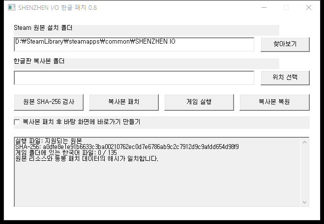
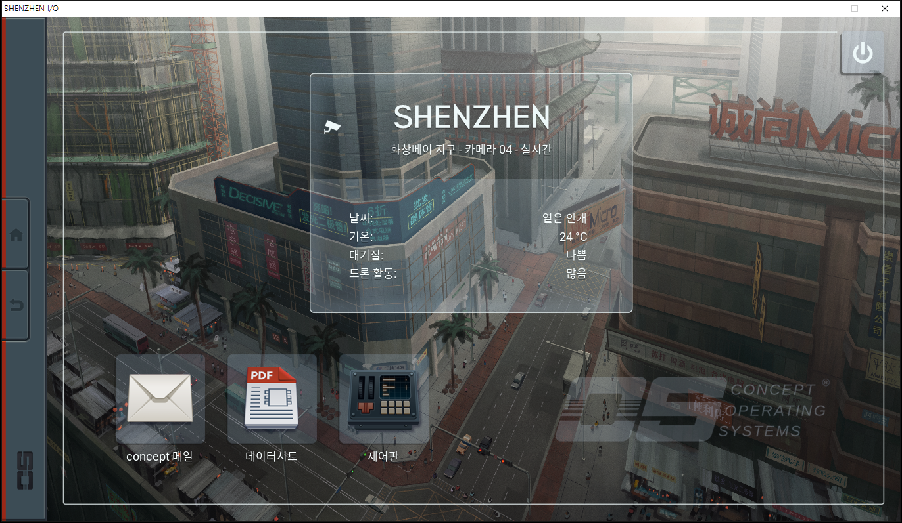
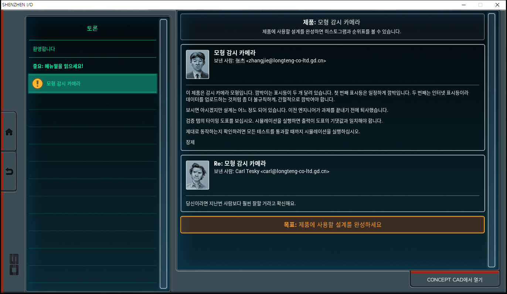
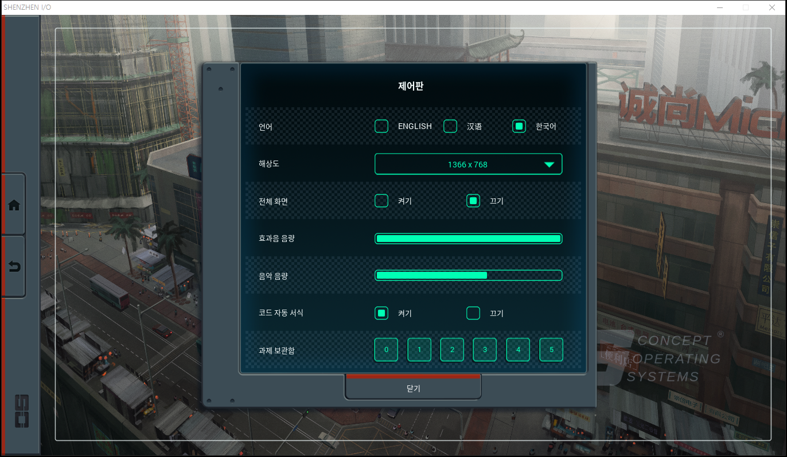

# SHENZHEN I/O 한글 패치 0.8

Windows Steam판 SHENZHEN I/O의 제어판에 **한국어**를 추가합니다. 게임 UI, 메일, 과제 설명을 한글로 표시하며, 한국어 상태에서 **데이터시트**를 누르면 한글 PDF 매뉴얼이 열립니다. 영어·중국어 선택지와 회로의 핀 이름, 부품 번호, 명령어 표기를 유지합니다.

Win32 x86 패처는 한국어 리소스와 한글 PDF를 내장한 단일 EXE입니다. 패처를 실행하기 위한 별도 Visual C++ 재배포 패키지나 .NET 런타임 설치가 필요 없습니다.

## 설치 및 실행

1. 게임을 닫고 `ShenzhenKoreanPatcher.exe`를 실행합니다.
2. **찾아보기**에서 Steam 설치 폴더를 선택합니다. 이 폴더에 `Shenzhen.exe`가 있어야 합니다.
3. **위치 선택**에서 한글판을 만들 위치를 고릅니다. 기본 복사본 폴더 이름은 `SHENZHEN IO Korean`입니다.
4. **원본 SHA-256 검사**로 지원 빌드를 확인합니다. 바탕 화면 바로가기를 원하면 체크한 뒤 **복사본 패치**를 누릅니다.
5. Steam에 로그인한 상태에서 **게임 실행**을 누릅니다. 게임의 **Control Panel → Language → 한국어**를 선택합니다.

패처는 복사본의 실행 파일과 내장 리소스를 검증합니다. 복사본의 저장 폴더는 `KoreanSaves`입니다. 이미 만든 한글판은 같은 복사본 경로에 다시 패치하면 업데이트됩니다. **복사본 복원**은 복사본의 실행 파일과 패치 리소스만 복원합니다.

## 화면

### Win32 패처

### 한글 메인 화면

### 한글 메일

### 언어 설정

## 지원 빌드

- 운영체제는 Windows 10 이상입니다.
- Windows Steam판 원본 `Shenzhen.exe` SHA-256은 `a0dfe8e1e91b6633c3ba00210762ec0d7e6786ab9c2c7912d9c9afdd654d98f9`입니다.
- 이 버전에서 회로 편집기의 이미지 버튼 일부는 영어로 표시됩니다.

## 한글 매뉴얼 출처

한글 PDF는 아래 출처의 매뉴얼을 `SHENZHEN IO Manual (Korean).pdf`라는 이름으로 패처에 내장합니다.

[SHENZHEN I/O 한글 매뉴얼 원문 게시물](https://blog.naver.com/dpotudf0/220956199248)

## 소스에서 빌드

빌드 도구, 로컬 원본과 PDF 입력 경로, 결과물 위치는 [빌드 안내](HOWTOCOMPILE.md)를 참고하세요.
